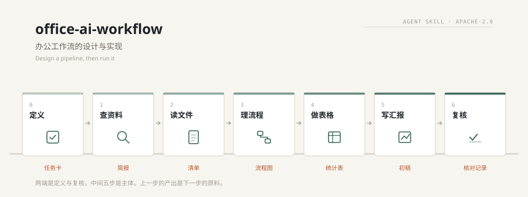
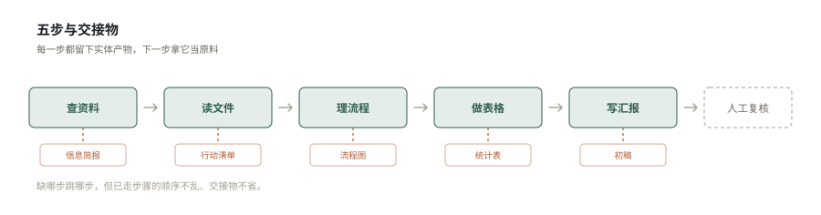

<div align="center">

[中文](./README.md) · **English**

# office-ai-workflow

#### Five recurring office tasks, chained into one pipeline

[](SKILL.md)
[](LICENSE)
[](https://agentskills.io)
[](#compatibility)

</div>

<p align="center">
  
</p>

---

> Research, read, map, tabulate, report. None of the five is hard on its own; chaining them is what saves time.
> Each step's output is the next step's input, and a person only checks the numbers and the conclusion.

One skill, one five-step pipeline. No scripts, no network, no packages. Drop the folder into your agent's skills directory and it runs.

## Why a pipeline

Using an assistant for one-off office tasks has three recurring failures:

| Failure | Cost |
|---|---|
| Close the window and start over | Formatting and wording decisions are lost |
| Re-explain the task every time | Vague briefs in, uneven output out |
| Intermediate artifacts are not kept | The numbers in the final deck do not reconcile |

The pipeline fixes the order and the handoffs: research feeds reading, reading feeds the action list, and the list plus the numbers land in the report. The method stays; only the inputs change.

## The five steps

<p align="center">
  
</p>

| Step | What happens | What it hands over |
|---|---|---|
| 1 | Research: bound the topic and the date range, produce a one-page brief | Brief (point / source / relevance) |
| 2 | Read: extract long documents by five fields, never paraphrase the whole thing | Action list (item / owner / due / source) |
| 3 | Map: turn the process into a flow or a responsibility chart | Flow with human review gates marked |
| 4 | Tabulate: unify the schema first, then aggregate, and state the formula | Stats table you can re-check |
| 5 | Report: five-slide skeleton, one conclusion per slide | Draft deck for human review |

You do not have to run all five. Skip what the task does not need, but keep the order of the steps you do run and never skip a handoff.

## Quick start

Send this to your assistant:

```
Use office-ai-workflow to turn these files into a monthly review.
Focus on customer feedback and blockers. Output a brief, an action list,
a stats table and a deck outline. Keep the original sources for every number.
```

It works the five steps one at a time and stops at each checklist before moving on.

## Install

```bash
git clone https://github.com/YardonYan/office-ai-workflow.git
cd office-ai-workflow
node tools/install.mjs --list      # see which apps are on this machine
node tools/install.mjs --ai all    # install to all of them
```

Zero dependencies, Node standard library only. Also supports `--dry-run`, `--force`, `--uninstall`, `--project` and `--dir`.

Or copy the folder manually so that `<skills-dir>/office-ai-workflow/SKILL.md` exists.

| App | Global directory |
|---|---|
| WorkBuddy | `~/.workbuddy/skills/` |
| CodeBuddy | `~/.codebuddy/skills/` |
| TRAE (CN) | `~/.trae-cn/skills/` |
| TRAE | `~/.trae/skills/` |
| Qoder (CN) | `~/.qoder-cn/skills/` |
| Qoder | `~/.qoder/skills/` |
| Qwen Code | `~/.qwen/skills/` |
| Lingma | `~/.lingma/skills/` |
| Kimi Code CLI | `~/.kimi/skills/` |
| iFlow CLI | `~/.iflow/skills/` |
| OpenClaw | `~/.openclaw/skills/` |
| CodeArts Doer | `~/.codeartsdoer/skills/` |
| Claude Code | `~/.claude/skills/` |
| Codex CLI | `~/.codex/skills/` |
| Cursor | `~/.cursor/skills/` |
| Shared convention | `~/.agents/skills/` |

Restart the app, or trigger a skills refresh, after installing.

## What's inside

The main file carries the order and the principles. Details live in four reference files, loaded only when needed.

| File | Content |
|---|---|
| `SKILL.md` | Three reasons to split, the pipeline, four things to brief before starting, checkpoints, failure handling |
| `references/why-and-how.md` | How others build pipelines: prompt chains, role relay, task orchestration, template-plus-variable; when splitting goes too far |
| `references/steps-deep.md` | Per-step inputs, actions, output definition, checklist, common mistakes, failure handling |
| `references/variants.md` | Six variants: three-step, weekly, monthly retrospective, meeting, competitor brief, chat-only |
| `references/scenarios.md` | Three extensions: client-facing material, cross-team output, adapting the five steps to your industry |
| `references/examples.md` | Three worked cases with real inputs, outputs and snags |

## Non-negotiables

1. The assistant drafts and organizes. Numbers, sources and conclusions get human review before they leave the room.
2. Keep the original evidence. Never invent figures, owners or dates. Mark missing fields instead of guessing.
3. Each step's checklist must pass before the next one starts.
4. Redact sensitive material before it enters the pipeline.

## Compatibility

Built on the [Agent Skills](https://agentskills.io) open standard: one directory, one `SKILL.md`, frontmatter limited to the fields the spec allows. Any tool that reads the standard loads it without conversion.

The skill itself needs no scripts, network or packages. The two files under `tools/` only install the skill and generate plugin manifests; deleting them does not break the skill.

## License

[Apache-2.0](./LICENSE), `Copyright 2026 YardonYan`.

