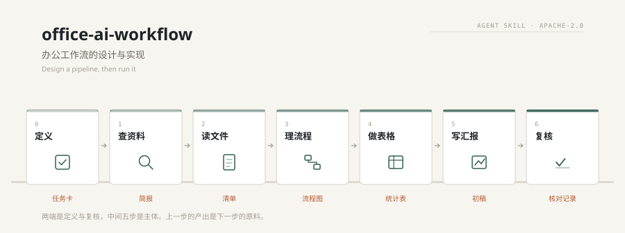
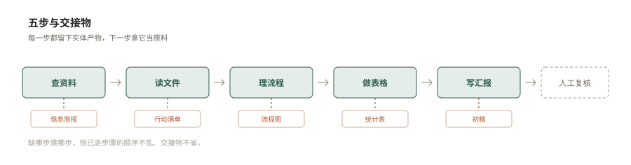

<div align="center">

**中文** · [English](./README.en.md)

# office-ai-workflow

#### 办公工作流的设计与实现

[](SKILL.md)
[](LICENSE)
[](https://agentskills.io)
[](#兼容性)
[](#七步)
[](#安装)

</div>

<p align="center">
  
</p>

---

> 别把 AI 当问答窗口。把零散办公活接成一条线：每步交代清楚，上一步的产物是下一步的原料，人只核对关键数字和结论。

这份 Skill 管两件事：**把一类活设计成流程**，和**按现成的流程把一次活干完**。

## 两种用法

| 你的处境 | 从哪开始 |
|---|---|
| 手上一件具体的活，想高效做完 | 直接走七步 |
| 一类活反复出现，每次都要从头想 | 读「怎么设计自己的工作流」，设计完再执行 |
| 已有流程但总卡在某一环 | 读「改造现有流程」，通常是缺交接物或口径没锁 |
| 想把流程交给别人用 | 读「写成别人能用的文档」 |

多数人卡在第二种：知道该用 AI，但不知道怎么下笔。这个仓的重点也在那一节。

## 七步

两端各加一步，中间五步是主体。两端那两步最容易被跳过，也最影响成败。

<p align="center">
  
</p>

| # | 步 | 交出什么 | 一句话 |
|---|---|---|---|
| 0 | 定义 | 任务卡 | 目标、范围、输出契约，三样写清再动手 |
| 1 | 查资料 | 信息简报 | 限定范围，收成能拿去做判断的三列 |
| 2 | 读文件 | 行动清单 | 五要素提取，不复述全文 |
| 3 | 理流程 | 流程图 | 标出并行、审核节点和交接点 |
| 4 | 做表格 | 统计表 | 先锁口径再算，公式写出来 |
| 5 | 写汇报 | 初稿 | 每页一个结论，数字引自统计表 |
| 6 | 复核 | 核对记录 | 数字、口径、结论三条对得上才交 |

步骤数不是死的。你的场景只有三步就写三步，有九步就写九步。判据只有一条：**这一步的输入、风险、完成标准，和下一步是否真的不同。**

## 怎么设计自己的工作流

给不知道怎么下笔的人。七个动作：

| 动作 | 关键判断 |
|---|---|
| 一、找重复 | 每天每周最烦的那件事，先做它 |
| 二、判断值不值得 | 下个月还做、超过半小时、每次做法不一样，中两个才值得 |
| 三、拆成决策点 | 按输入、风险、完成标准拆，不按文件大小拆 |
| 四、定输入输出契约 | 完成标准要能判断是或否 |
| 五、串成骨架 | 每两步之间必须能写出一个实体名词 |
| 六、拿真事跑一遍 | 看哪一步卡住、哪一步的产物下一步用不上 |
| 七、固化 | 提示词变模板、产物存样例、写清不适用范围 |

完整版含六个常见陷阱和三个断点修法，见 [`references/design.md`](./references/design.md)。

## 写成别人能用的文档

流程设计完，只有自己会用等于没有。分享时按八段写：

用途（含**不做什么**）· 什么时候用 · 输入（含**什么算坏输入**）· 输出契约 · 护栏 · 示例 · 运行说明 · 变更记录

最容易被跳过的是输出契约和坏输入说明，这两样恰恰决定别人能不能用起来。写法见 [`references/sharing.md`](./references/sharing.md)。

## 模板

`templates/` 下七份，复制就能用。每份含输入说明、提示词原文、输出契约、验收清单、失败处理。

| 模板 | 用在什么时候 |
|---|---|
| [`00-define.md`](./templates/00-define.md) | 开工前把边界定义清楚 |
| [`01-brief.md`](./templates/01-brief.md) | 零散信息收成一页简报 |
| [`02-extract.md`](./templates/02-extract.md) | 长文档里拿出行动清单 |
| [`03-map.md`](./templates/03-map.md) | 把多环节的事画成图 |
| [`04-stats.md`](./templates/04-stats.md) | 台账变成能进汇报的统计 |
| [`05-report.md`](./templates/05-report.md) | 材料齐了，出汇报大纲 |
| [`06-weekly.md`](./templates/06-weekly.md) | 每周固定交周报，三步精简版 |

## 输出契约

每一步的产物长什么样，事先写死。写完对着核，比事后返工便宜。

| 步 | 产物 | 硬性要求 |
|---|---|---|
| 0 | 任务卡 | 四问有答案，含一句「不做什么」 |
| 1 | 信息简报 | 三列，最多四行，每行可溯源 |
| 2 | 行动清单 | 事项是动词开头，负责人不臆造 |
| 3 | 流程图 | 并行不画成串行，审核节点不省 |
| 4 | 统计表 | 分类合计等于总数，公式写在表下 |
| 5 | 汇报大纲 | 每页一个结论，标题是结论句 |
| 6 | 核对记录 | 三处数字、口径、结论逐条写明 |

## 三十秒上手

把这句话发给 AI：

```
用 office-ai-workflow，帮我把这几个文件整理成本月复盘。
重点是客户反馈和进度卡点，输出简报 + 行动清单 + 统计表 + PPT 大纲，
数字必须保留原始依据，不要臆造。
```

它会拆成几步做，每步停下来给你过检查清单，再进下一步。

## 安装

```bash
git clone https://github.com/YardonYan/office-ai-workflow.git
cd office-ai-workflow
node tools/install.mjs --list          # 看本机能装到哪些应用
node tools/install.mjs --ai all        # 一次装到全部
```

零依赖，只用 Node 标准库。支持 `--dry-run` 预览、`--force` 覆盖、`--uninstall` 卸载、`--project` 装进当前项目、`--dir` 装到自定义目录。

手动放也行，保证 `<技能目录>/office-ai-workflow/SKILL.md` 这个层级存在。

| 应用 | 全局目录 |
|---|---|
| WorkBuddy | `~/.workbuddy/skills/` |
| CodeBuddy | `~/.codebuddy/skills/` |
| TRAE 国内版 / 国际版 | `~/.trae-cn/skills/` · `~/.trae/skills/` |
| Qoder 国内版 / 国际版 | `~/.qoder-cn/skills/` · `~/.qoder/skills/` |
| QoderWork | `~/.qoderwork/skills/` |
| Qwen Code | `~/.qwen/skills/` |
| 通义灵码 | `~/.lingma/skills/` |
| Kimi Code CLI | `~/.kimi/skills/` |
| iFlow CLI | `~/.iflow/skills/` |
| CodeArts Doer | `~/.codeartsdoer/skills/` |
| OpenClaw | `~/.openclaw/workspace/skills/` |
| Claude Code | `~/.claude/skills/` |
| Codex CLI | `~/.codex/skills/` |
| Cursor | `~/.cursor/skills/` |
| 通用约定 | `~/.agents/skills/` |

## 内含

| 文件 | 内容 |
|---|---|
| `SKILL.md` | 主册：两种用法、七步、设计方法、改造、文档化、检查点、失败处理 |
| `references/design.md` | 从零设计的完整版：三种起点、记录真实过程、六个陷阱、最小可用流程 |
| `references/sharing.md` | 怎么写文档：八段结构、三种形态、第一屏、维护 |
| `references/why-and-how.md` | 别人怎么搭流水线：四种流派与共有机制 |
| `references/steps-deep.md` | 每步的输入、动作、产物定义、检查项、常见错误 |
| `references/variants.md` | 六种变体：三步精简、周报、复盘、会议、竞品、纯对话 |
| `references/scenarios.md` | 客户材料、跨部门、行业流程改造 |
| `references/examples.md` | 三个完整案例 |
| `templates/` | 七份可直接复制的提示词模板 |

## 硬性底线

1. AI 负责整理和起草；关键数字、原始依据和最终结论必须人工核对后才能对外使用。
2. 保留原始依据，不臆造数据、不补造负责人和日期；字段缺失明确标注，不猜。
3. 每步的检查清单过完才进下一步；不过关就修，不跳闸。
4. 涉及敏感信息先脱敏再进流水线。

## 兼容性

按 [Agent Skills](https://agentskills.io) 开放标准组织：一个目录、一个 `SKILL.md`、frontmatter 只含规范允许的字段。支持该标准的工具都能直接加载，不需要转换。

技能本身不依赖脚本、网络和第三方包。`tools/` 下两个脚本只用于安装和生成图与插件清单，删掉不影响技能工作。

## 贡献

模板和场景变体都收。格式要求见 [`CONTRIBUTING.md`](./CONTRIBUTING.md)。

## 许可

[Apache-2.0](./LICENSE)，版权行 `Copyright 2026 YardonYan`。
