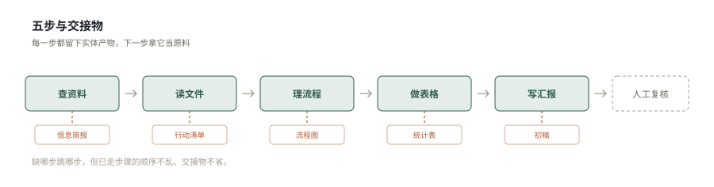

# office-ai-workflow — 办公工作流的设计与实现

别把 AI 当问答窗口。把零散办公活接成一条线：每步交代清楚，上一步的产物是下一步的原料，人只核对关键数字和结论。

这份 Skill 管两件事：**把一类活设计成流程**，和**按现成的流程把一次活干完**。

## 两种用法

| 你的处境 | 从哪开始 |
|---|---|
| 手上一件具体的活，想高效做完 | 直接跳到七步，按顺序走 |
| 一类活反复出现，每次都要从头想 | 先看「怎么设计自己的工作流」，设计完再执行 |
| 已有流程但总卡在某一环 | 看「改造现有流程」，通常是缺交接物或口径没锁 |
| 想把流程交给别人用 | 看「写成别人能用的文档」 |

多数人卡在第二种：知道该用 AI，但不知道怎么下笔。这份文档的重点也在那一节。

## 为什么值得做成流水线

单点用 AI 做办公任务，常见三个毛病：

| 毛病 | 后果 |
|---|---|
| 问完就关窗口 | 下次重新交代背景，调好的格式和说法全丢 |
| 每次重新描述需求 | 任务模糊、资料零散，结果时好时坏 |
| 中间产物不留存 | 拼汇报时材料还是散的，数字口径对不上 |

拆开之后能拿到三样东西：

**一、单步的认知负担降下来。** 让 AI 同时考虑选题、结构、语气、配图、合规，它顾此失彼，输出看着完整、每项都不到位。一次只让它干一件事，判断质量明显不一样。

**二、中间产物能检查。** 一步写出两千字，要改只能推翻重来。先出简报，方向偏了当场调；再出清单，缺项当场补。改的粒度小，返工就少。

**三、不同步骤能用不同策略。** 查资料要发散，越想越全；写汇报要收敛，一句一个结论。一步到位只能用一种策略。

反过来说，一件事如果只有一个动作、一次判断，拆开只是增加交接成本。这种不要用流程，直接做。

## 七步

两端各加一步，中间七步是主体。

  

| # | 步 | 交出什么 | 产物类型 | 一句话 |
|---|---|---|---|---|
| 0 | 定义 | 任务卡 | 文本 | 目标、范围、输出契约，三样写清再动手 |
| 1 | 查资料 | 信息简报 | 表（三列） | 限定范围，收成能拿去做判断的三列 |
| 2 | 读文件 | 行动清单 | 表（四列） | 五要素提取，不复述全文 |
| 3 | 理流程 | 流程图 | 图 | 标出并行、审核节点和交接点 |
| 4 | 做表格 | 统计表 | 表（含公式） | 先锁口径再算，公式写出来 |
| 5 | 写汇报 | 初稿 | 文（分页） | 每页一个结论，数字引自统计表 |
| 6 | 复核 | 核对记录 | 文本 | 数字、口径、结论三条对得上才交 |

两端那两步最容易被跳过，也最影响成败。

## 第 0 步 定义：把四件事交代清楚

结果不稳定，多半不是工具不行，是任务描述太模糊。

| # | 交代什么 | 反例 | 正例 |
|---|---|---|---|
| 1 | 要解决什么 | 做个复盘 | 完成 10 月例会复盘，供周会用 |
| 2 | 重点看什么 | 都看看 | 客户反馈、进度卡点 |
| 3 | 输出成什么 | 一份报告 | 简报 + 清单 + 统计表 + 五页大纲 |
| 4 | 按什么标准验收 | 差不多就行 | 数字有出处，不臆造负责人 |

资料交出去之前先自查：文件名清楚、时间范围一致、统计口径一致、敏感信息已脱敏。

这四件事写下来就是任务卡，模板见 `templates/00-define.md`。

## 第一步 查资料：零散信息 → 一页简报

不是把网页复制一遍，是先限定主题、时间范围和判断重点，再收成能用于决策的简报。

三步：明确主题 → 设定范围（标注来源和时间）→ 输出三到五条结论。

成品是三列表：信息点、来源、与工作的关系。超过五条说明筛得不够。

检查：每条能点回来源、时间在范围内、结论能支撑判断、没有无关内容。

## 第二步 读文件：长文档 → 行动清单

不让 AI 复述全文，直接按五要素提取：关键结论、待办事项、负责人、截止时间、原文依据。

四条原则：先要行动不要长摘要、每条保留原文依据、负责人和时间单独列出、无法判断的宁可留空。

检查：每条能回到原文、没有编造负责人、待办是动作不是状态、背景没被误当成待办。

## 第三步 理流程：复杂事情 → 一张图

推进慢往往不是事难，而是谁先做、做到哪一步、谁来确认没说清。

两种画法按需选：流程图讲顺序，职责图讲分工，不要混在一张。

四个易错点：并行被画成先后、漏掉人工审核、责任人和执行人混为一谈、箭头很多但动作含义不清。

## 第四步 做表格：台账 → 统计表

最有价值的不是把数据抄漂亮，是先统一字段和口径，再做汇总。

三步：统一字段 → 分类汇总 → 生成图表。公式必须写出来，例如完成率 = 已完成 ÷ 总数。

检查：字段口径一致、空值没被当 0、计算过程能复核、图表和表格一致。

## 第五步 写汇报：材料 → 汇报结构

汇报不是堆信息，是每页只表达一个结论。前面几步的简报、清单、统计表在这里拼装。

五页骨架：目标、进展、数据、问题、下月计划。

四条原则：先有结论再放材料、数据口径与统计表一致不另算、一页不塞太多点、行动建议要能落地。

交付的是高质量初稿。做 PPT 成稿走你本地的幻灯片技能。

## 第六步 复核：交出去之前的最后一道

这一步不做，前面全白费。三条，逐条过：

| 查什么 | 怎么查 | 不合格就 |
|---|---|---|
| 数字 | 抽查三处，回到统计表核对 | 改回统计表的值，不要改统计表迁就汇报 |
| 口径 | 前后说法一致吗（时间范围、完成定义） | 回到第四步重锁 |
| 结论 | 材料撑得起这句话吗 | 缩小结论范围，或退回补材料 |

复核结果写成一行记录，例如「抽查 5 个数字全部一致；口径为 10 月自然月；结论已收窄到可控范围」。

## 编排原则

七条，优先级高于任何单步的做法。冲突时以这七条为准。

**一、先判类型，再动手。** 接到活先问三句：这是做一次还是建流程？要交的是什么形态？手上有没有现成材料？三句没答完不要开工。

**二、按交付物分路，不按任务名。** 「做个月度复盘」可能是要一份文档，也可能是要一页纸讲五分钟，路线完全不同。同一个名字底下是两条路，看的是最终交什么，不是它叫什么。

**三、组合优先于穷举。** 七步是标准组合，不是唯一答案。真实场景千变万化，穷举不完。记住每步的能力和衔接规则，遇到没见过的场景自己组合，比找「有没有现成的模板」快得多。

**四、类型必须衔接。** 每一步的产物都有类型（表、图、文），下一步只能吃对得上的那种。写汇报要的是数字，前面就必须做过表格；要画流程就得先有清单。接不上的地方，就是漏了一步。

**五、关键定义只写一次。** 交接物和产物要求只在下表定义一次，别的地方引用它，不重复写。重复定义的地方，改一处忘一处，最后一定对不上。

**六、中间产物不外发。** 简报、清单、流程图、统计表都是中间态，只在检查点里给路径和一句摘要，不要整理成漂亮格式发给别人。唯一对外交付的是复核过的初稿。

**七、每一步留一句溯源。** 不是打勾，是写清「查了什么、结论是什么」。例如「简报已过，来源 6 条全可追溯」。这句话进下一步的上下文，后面的人知道哪里可靠、哪里是空的。

## 什么时候启动

七步管怎么做，这一节管什么时候开始做。

大部分人的流程是人驱动的：所有事的起点都是自己。真正的瓶颈不是工具，是注意力。

三类触发信号，按投入产出选：

| 类型 | 例子 | 什么时候用 |
|---|---|---|
| 定时 | 每周五 16:00 出周报 | 节奏稳定、内容可预期 |
| 事件 | 项目结项当天出复盘、会议结束当天出纪要 | 事后有时效要求 |
| 阈值 | 返工率超 20%、延期超三天 | 只在异常时启动，最省力气 |

多数人只用了第一种。真正省时间的是后两种。

规则写成一张表：什么信号、做什么、谁做、**什么时候告诉我**。最后一列最重要，写清什么情况下才来找人，才真的省下注意力。

更细的做法见 `references/automation.md`。

## 交接规则

前一步交出什么、后一步拿什么用，必须说清楚。**以下为全文唯一定义，其他小节只引用不复述。**

| 交出方 | 交接物 | 下一步怎么用 |
|---|---|---|
| 定义 | 任务卡 | 圈定后面所有步的范围 |
| 查资料 | 信息简报 | 圈定读文件的主题与范围 |
| 读文件 | 行动清单 | 待办、负责人、时间进流程图和台账 |
| 理流程 | 流程图 | 作为汇报「进展」页的说明材料 |
| 做表格 | 统计表 | 口径锁死，汇报里的数字不得另算 |
| 写汇报 | 初稿 | 进复核，再交人工 |
| 复核 | 核对记录 | 附在初稿后，交出去时一起给 |

每完成一步先输出交接物、过检查清单，再进下一步。不要七步一口气跑完才给结果。

## 怎么设计自己的工作流

这一节给不知道怎么下笔的人。七个动作，按顺序做。

### 一、先找重复

不要一上来就想建个大系统。先问：我每天、每周，什么事最重复？

写下来，一句话一件。典型的有：写周报、整会议纪要、做客户反馈汇总、整理台账、做竞品简报。

找三条就够，先做最烦的那条。

### 二、判断值不值得做成流程

三个信号，中两个才值得：

- 这件事下个月还会再做
- 每次都要花超过半小时
- 每次做法不太一样，导致质量波动

反例：一次性的事、十分钟能做完的事、只有自己看不需要给别人看的事。这些做完算数。

### 三、拆成决策点，不是拆成文件

判据只有一条：**这一步的输入、风险、完成标准，和下一步是否真的不同。**

不同才拆，只是换个说法就合并。

拆过头的三个信号：相邻两步之间没有真正的交接物、合并后提示词没变长多少、检查点里有一半在确认上一步做过。

### 四、给每一步定输入和输出契约

整套方法里最值钱、也最常被跳过的一步。

| 定什么 | 问自己 |
|---|---|
| 输入 | 需要什么材料？格式？没有的话能不能跑？ |
| 输出 | 长什么样？几列？几条？必须含哪些字段？ |
| 完成标准 | 什么情况下算这一步做完了，可以进下一步 |

完成标准要能判断是或否。写「输出一份报告」不行，写「三列，最多四行，每行可溯源」才行。

### 五、串成骨架，检查交接物

把步骤排成一列，在每两步之间写一个实体名词：简报、清单、流程图、统计表。

如果某两步之间写不出名词，说明这两步该合并。

### 六、拿一件真事跑一遍

设计完不要直接拿去用。找一件上周真的做过的事，用新流程重做一遍。

重点看三处：哪一步卡住了、哪一步的产物下一步用不上、哪一步的检查清单过不去。

卡住的地方通常就是拆错了，或者输入没定义清。

### 七、固化

跑通之后做三件事：

1. 把每步的提示词写成模板，变量用 `{占位符}` 标出
2. 把这次的产物存一份当样例，下次照着对比
3. 写一句「什么时候不该用」，防止套到不适用的场景

到这一步流程才算建完。不固化的流程，第二次就忘了。

## 改造现有流程

已经有流程但总卡住，通常是五个原因之一。

| 症状 | 病因 | 改法 |
|---|---|---|
| 每次都要重新交代背景 | 缺第 0 步定义 | 补一张任务卡，固定四问 |
| 中间产物下一步用不上 | 交接物没定义 | 每两步之间写清交出什么、拿来干什么 |
| 数字总对不上 | 口径锁得太晚 | 只在做表格那步锁一次，后面全部引用 |
| 做完不知道对不对 | 缺复核 | 补第六步，抽查三处数字 |
| 换个人就用不了 | 全在脑子里 | 提示词写成模板，产物存样例 |

改造不需要推倒重来。先补最缺的那一环，跑一次，再补下一个。

## 写成别人能用的文档

工作流设计完，只有自己会用等于没有。分享时按八段写，缺哪段都会有人问。

| 段 | 写什么 | 常见缺陷 |
|---|---|---|
| 用途 | 做什么，**明确不做什么** | 只写做什么，用的人会拿它干别的 |
| 什么时候用 | 什么信号出现说明该用它 | 写「提升效率」，等于没说 |
| 输入 | 必填、选填、默认值、**什么算坏输入** | 只列字段，不说没有会怎样 |
| 输出契约 | 结构、必需字段、完成标准 | 写「输出一份报告」 |
| 护栏 | 什么时候该反问、该拒绝什么、隐私边界 | 不写，于是遇错就编 |
| 示例 | 一条正例，一条边界用例 | 只给正例，用的人不知道边界在哪 |
| 运行说明 | 怎么跑，产物存哪 | 缺，于是每个人存的地方都不一样 |
| 变更记录 | 改过什么，为什么 | 缺，于是没人知道该用哪版 |

最容易被跳过的是**输出契约**和**什么算坏输入**。这两样恰恰决定别人能不能用起来。

更细的写法，包括每种文档的骨架和常见错误，见 `references/sharing.md`。

## 语料怎么用

写周报、月报、纪要、邮件、方案、复盘时，不必从空白页开始。`references/corpus/` 下有三份：

| 文件 | 里面有什么 | 什么时候翻 |
|---|---|---|
| `00-sources.md` | 每份语料的来源、方法论出处、核验方式 | 想知道某个说法可不可信 |
| `01-formats.md` | 六种文档的骨架，每种带判据和常见错误 | 不知道分几段、每段该放什么 |
| `02-phrases.md` | 按位置分的措辞库：开场、进展、成果、问题、计划、收尾 | 知道要说什么，但写出来干巴巴 |
| `03-samples.md` | 六篇完整范文，覆盖运营、项目、会议、邮件、方案、复盘 | 想看看成型的什么样 |
| `04-real/` | 真实产出与收录规范，含脱敏红线 | 想放自己的真实案例进来 |
| `05-walkthrough/` | 两份完整走查：月度复盘（七步）、竞品简报（两步） | 想看看合格的长什么样 |

用法是拆开用，不是整篇套：结构照抄，句式改写，数据全换。

有一条值得单独记：**进展表述里，动词决定信息量。** 推进、跟进、处理、优化这些词单独用等于没说，后面必须跟宾语和结果。

## 检查点怎么设

三条规矩：

**一、检查点放在交接处，不放在开头。** 开头检查等于没做，因为还没有产物可查。

**二、不过关就停。** 上一步口径没锁死，下一步的数字全是错的，改起来比重做贵。

**三、检查结果留一句结论。** 不是打勾，是写一句「简报已过，来源 6 条全可追溯」。这句进下一步的上下文。

## 卡住了怎么办

| 卡在哪 | 症状 | 怎么办 |
|---|---|---|
| 输入不全 | 缺文件、缺负责人、缺时间范围 | 停下来列清单，标明缺什么、谁能补、什么时候要。不要用假设填空 |
| 来源冲突 | 两份材料数字不一样 | 两个都列出来，写清各自出处和差异，让人判断 |
| 口径不一致 | 上一步按 30 天算，这一步按自然月 | 回到做表格那一步重锁，不要在汇报里硬圆 |
| 产物不合格 | 检查清单过不去 | 就地重做这一步，不要带着问题往下走 |

还有一种不算卡住：产物不够漂亮但事实和口径都对。往下走，美化留到最后。

## 什么时候不该用

| 情况 | 为什么不用 |
|---|---|
| 只有一个动作的任务 | 拆开只是多两次交接 |
| 结论已经定了，只需要成文 | 直接写 |
| 一次性、不会重复的事 | 建流程的成本高于做一次 |
| 高度依赖临场判断的事 | 谈判、危机公关，步骤固化反而束缚 |
| 数据本身没准备好 | 流程解决不了垃圾进垃圾出 |

判断标准一条：这件事下个月还会再做一遍吗。

## 不承接的情况与去向

有些事看着像办公流，其实不该走这条线。分清楚，能省很多时间。

| 情况 | 去向 |
|---|---|
| 在既有文件上改一处措辞、调一个格式 | 直接改，不启动流程 |
| 只要一段话、一个数、一个判断 | 直接答，别套七步 |
| 要做成稿 PPT | 交给你本地的幻灯片技能，这里只到大纲 |
| 要写代码、改代码 | 交给编程类技能 |
| 谈判、危机公关、绩效面谈 | 高度依赖临场判断，流程会束缚 |
| 材料本身还没准备好 | 先解决材料，流程解决不了垃圾进垃圾出 |

判断方法：如果这件事只需要一次判断或一个动作，就不用流程。流程是为「多次交接、多人协作、要留档」准备的。

## 复用：换四个输入，留一套方法

下次复用只替换四样：新的源文件、新的时间范围、新的统计口径、新的汇报主题。

不能省的四样：来源与依据、人工检查、数据复核、敏感信息处理。

## 硬性底线

1. AI 负责整理和起草；关键数字、原始依据和最终结论必须人工核对后才能对外使用。
2. 保留原始依据，不臆造数据、不补造负责人和日期；字段缺失明确标注，不猜。
3. 每步的检查清单过完才进下一步；不过关就修，不跳闸。
4. 涉及敏感信息先脱敏再进流水线。

## 分册

| 文件 | 什么时候看 |
|---|---|
| `references/why-and-how.md` | 想知道这套方法从哪来、别人是怎么搭流水线的 |
| `references/design.md` | 要从零设计自己的工作流，需要更细的判断标准与常见陷阱 |
| `references/mindset.md` | 怀疑任务本身问错了、方案不确定对不对、流程越加越长 |
| `references/automation.md` | 想让流程不用靠人记，或者判断步骤是不是太多 |
| `references/maturity.md` | 想知道自己这条流程在什么水平、会不会出事、该不该继续升级 |
| `references/steps-deep.md` | 具体某一步不会做，要看输入输出定义和常见错误 |
| `references/variants.md` | 手上的任务不是完整七步，要挑一个变体 |
| `references/scenarios.md` | 要给客户交东西、跨部门联合出品、或换成本行业流程 |
| `references/sharing.md` | 要把流程写成文档给别人用，参照现成写法 |
| `references/examples.md` | 想照着完整案例走一遍 |
| `examples/` | 六份 HTML 成品，直接打开看效果 |
| `references/corpus/` | 语料：六种文档骨架、措辞库、六篇范文 |
| `templates/` | 七份提示词模板，加可选的 `pipeline-state.yaml`（进度状态）与 `rules.json`（触发规则） |
